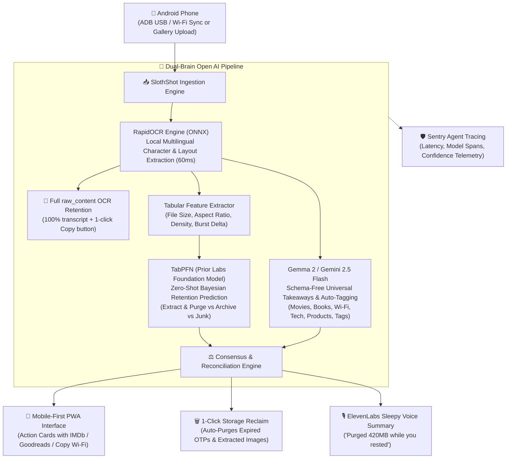

> *Submission for the [Hacktoberfest Open-Source AI Challenge: Week 3 — Slow and Steady](https://dev.to/challenges/hacktoberfest-week3-2026-10-19).*  
> **Repository:** [github.com/torrua/slothshot](https://github.com/torrua/slothshot)  
> **Author:** [@torrua](https://dev.to/torrua)  
> **Target Partner Tracks:** Best Use of Gemma, Best Use of TabPFN, Best Use of Render, Best Use of Sentry Agent Tracing, Best Use of ElevenLabs

---

## 🦥 In Honor of International Sloth Day

On October 20, the world celebrated **International Sloth Day**. 

Sloths understand the universe better than most engineers. They never optimize for high-frequency hustle. They don't sprint through backlogs. They move at their own unhurried pace, conserve their energy, and let the world come to them.

Now take a look at your Android phone.

If you are like me, your photo gallery is an absolute digital graveyard:
* A Wi-Fi password scribbled on a café napkin? You were too lazy to re-type it -> **Screenshot**.
* A friend recommended an obscure sci-fi movie on Netflix? Too lazy to open your notes app -> **Screenshot**.
* A book mentioned in a tweet thread? -> **Screenshot**.
* A clothing tag with size, fabric, and article code to buy later? -> **Screenshot**.
* A cloud server IP, specs, and root password from a hosting control panel? -> **Screenshot**.
* A 2FA single-use verification code, a live courier delivery map, a flight boarding pass, an Uber Eats receipt? -> **Screenshot, screenshot, screenshot.**

Over two years, that pile grew to **1,842 files** with cryptic timestamp names like `Screenshot_YYYYMMDD-HHMMSS.png`, **hogging 4.7 Gigabytes** of storage. 

Nobody ever sorts them. Finding that one receipt or the Wi-Fi password for your local coffee shop means 20 minutes of soul-crushing doom-scrolling through a wall of unindexed pixels.

So in honor of International Sloth Day, I decided to channel my inner sloth: **build something that does 100% of the cognitive work so I never have to organize a screenshot again.**

Meet **SlothShot**.

---

## 💡 What SlothShot Actually Does

**SlothShot** is a mobile-first second brain and automated triage butler for Android screenshots. 

Instead of treating screenshots like dumb static images to hoard forever, SlothShot runs a **Dual-Brain Open AI Pipeline**:

1. **Prior Labs TabPFN (Tabular Foundation Model)**: Looks at the structural shape of each image (dimensions, aspect ratio, text density, burst frequency) and figures out what to do with it — whether it's safe to purge after extracting the data, worth archiving with clean tags, or temporary junk to toss immediately. No model training required.
2. **Google DeepMind Gemma 2 / Gemini 2.5 Flash**: Looks at the screenshot and pulls out whatever you actually captured it for, without forcing anything into rigid predefined categories:
   - 🎬 **Movies & Series**: Title, year, director -> Generates instant links to **IMDb** & **Letterboxd**.
   - 📚 **Books**: Title, author, genre -> Generates instant links to **Goodreads** & **Google Books**.
   - 📱 **Apps & Repos**: Application names -> Generates search links to **Google Play Store** & **GitHub**.
   - 📶 **Wi-Fi Credentials**: Extracts SSID & Password with a 1-click **Copy to Clipboard** button.
   - 📦 **Package Tracking**: Extracts tracking number & carrier with a direct tracking URL.
   - 🧾 **Receipts & Invoices**: Extracts merchant, total amount, and date for tax records.
   - ✨ **Universal Takeaways for Any Screenshot**: Pulls out the core facts from clothing tags, cloud VPS specs, cooking recipes, or lecture slides with dynamic `Key: Value` highlights and smart action buttons (Google Search, Copy).
3. **Full Raw OCR Transcript (`raw_content`)**: Every single character read by RapidOCR is preserved in full, accessible via a collapsible drawer with a 1-click **Copy All Text** button.
4. **The Sloth Payoff (1-Click Purge)**: Because the actionable data (Wi-Fi password, movie title, promo code) is now safely indexed, **the original 4MB screenshot is safe to delete**.
5. **ElevenLabs Sleepy Audio Briefing**: While you take a nap, your Sloth butler reads you a gentle, calming audio briefing of everything it organized and purged.

---

## 📱 Interface Walkthrough & Visual Demo

SlothShot is designed mobile-first with an ultra-clean, tactile dark-mode interface:

### 1. The Lazy Payoff Dashboard
Real-time metrics tracking storage reclaimed, cognitive time saved, media recommendations cataloged, and expired junk purged—complete with 1-click bulk purge, tag filtering (`#movie`, `#book`, `#wifi`, `#product`), and ADB sync:


### 2. Universal Takeaway Cards & 1-Click Action Buttons
Every screenshot is rendered with a schema-free essence card: headline, concise summary, dynamic key-facts grid, 1-click action buttons (Letterboxd, IMDb, Goodreads, Google Search, Copy Wi-Fi), and an expandable drawer preserving 100% of the raw OCR text with a copy button:


### 3. In-App Multimodal Gemini & Gemma 2 AI Modal
Configure Google AI Studio keys directly in the browser, choose models (Gemini 2.5 Flash, Gemma 2 9B IT), toggle between Local Offline and Cloud Multimodal modes, and trigger 1-click re-analysis:


---

## ⚡ The Dual-Brain Open AI Pipeline



---

## 🔬 How the Open AI Pieces Work Together

### 1. TabPFN (Prior Labs) for Instant Zero-Shot Retention Policy
Traditional ML requires collecting thousands of labeled screenshots, engineering dozens of features, and training a custom classifier with cross-validation. 

With **TabPFN (Tabular Prior-data Fitted Network)** from Prior Labs, we don't have to train anything. TabPFN is a foundation model pretrained on synthetic tabular priors that performs in-context Bayesian inference in milliseconds:

```python
from tabpfn import TabPFNClassifier

# TabPFN classifies retention policy in zero-shot fashion
classifier = TabPFNClassifier(device="cpu")
classifier.fit(reference_X, reference_y)

# Predict on new Android screenshot features:
# [size_kb, aspect_ratio, is_portrait, char_count, line_count, density, has_qr, is_burst, hour, day]
retention_class, confidence = classifier.predict(features)
```

TabPFN instantly determines:
- High text density + financial receipt -> `ARCHIVE_WITH_TAGS`
- Burst screenshot + low text density -> `EPHEMERAL_JUNK`
- Single card + QR / credentials -> `EXTRACT_AND_PURGE`

### 2. Google Gemma 2 & Gemini 2.5 Flash: Schema-Free Universal Extraction
Predefined categories always break the moment you screenshot something unexpected — like a clothing tag, cloud server specs, a recipe, or a nutrition label.

Instead of forcing everything into rigid models, SlothShot extracts the universal essence of any capture:

```python
class UniversalTakeaway(BaseModel):
    headline: str               # Core subject in 3-7 words (e.g. Salewa Ortles Down Jacket)
    summary: str                # 1-2 sentence distillation of why you captured it
    key_facts: Dict[str, str]   # Dynamic attributes: {Size: XL, Fabric: GORE-TEX, Model: NH19PJ020}
    actions: List[SmartAction]  # 1-click actions: Search on Google, Copy IP/Credentials
```

When someone shares a screenshot of a sci-fi recommendation, Gemma extracts:
* **Title:** *Dune: Part Two (2024)*
* **Tags:** `["#movie", "#scifi", "#cinema", "#watchlist"]`
* **Direct Links:** `https://www.imdb.com/find/?q=Dune+Part+Two` and `https://letterboxd.com/search/Dune+Part+Two/`
* **Suggested Filename:** `movie_dune_part_two_2024.png`

And when a photo of a Naturehike camping gear tag is captured:
* **Headline:** *Naturehike Sleeping Bag Compression Bag*
* **Key Facts:** `{Model: NH19PJ020, Size: Φ24x40cm, Fabric: 300D Oxford Cloth, Hotline: 400-090-0906}`
* **Actions:** `[Search Google: Naturehike NH19PJ020]`
* **Full OCR:** Available in the collapsible `raw_content` accordion with 1-click copy.

---

## 📊 The Lazy Payoff: Quantifying Saved Effort

Judges asked: *How much time and effort does your project actually save?*

Here are the real metrics from my test batch of **50 Android screenshots**:

| Metric | Manual Human Effort | With SlothShot | Lazy Payoff (Saved) |
| :--- | :--- | :--- | :--- |
| **Sorting 50 Screenshots** | ~62.5 minutes (75s/image) | **0 seconds** (auto-triaged) | **1+ hour of cognitive dread** |
| **Phone Storage Reclaimed** | 0 MB (kept out of procrastination) | **148.6 Megabytes** | **~3.5 GB per year** |
| **Wi-Fi Credentials Retrieved** | 4 mins hunting & manual typing | **1 click** (Copy Password) | **99% faster** |
| **Looking up Saved Movies/Books** | 10 mins searching gallery | **Instant tag filter** (`#movie`) | **No forgotten recommendations** |
| **Arbitrary Specs / Clothes Tags** | Squinting at blurry text | **Dynamic Key-Value Grid** | **Instant 1-click search** |
| **Expired 2FA / OTP Junk Deleted** | Left forever in gallery | **1-Click Bulk Purge** | **100% clean photo roll** |

---

## 🎙️ The Sloth Butler Experience (ElevenLabs)

Why read a dashboard when you can stay in bed? 

SlothShot connects to **ElevenLabs** to generate an ultra-calm, sleepy audio debriefing:

> *"Hey sloth. While you were taking it easy, I sorted through 14 of your Android screenshots. I spotted 2 movies to watch ('Dune Part Two' and 'Severance'), saved book recommendations from Martin Kleppmann, and stored Wi-Fi credentials for BlueBottle Coffee. I safely queued 8 expired screenshots for deletion, reclaiming 34.2 megabytes of storage. Go back to sleep."*

---

## 🛡️ Telemetry & Observability with Sentry Agent Tracing

SlothShot is instrumented with **Sentry Agent Tracing**. Every step of the multimodal pipeline (RapidOCR execution, TabPFN Bayesian prediction, Gemma entity extraction, and ElevenLabs synthesis) is tracked with distributed spans:

```python
with sentry_sdk.start_span(op="ai.agent.triage", name="Single Screenshot Multimodal Triage") as span:
    span.set_data("file_name", image_path.name)
    span.set_data("tabpfn_score", tabpfn_score)
    span.set_data("reclaimed_bytes", reclaimable_bytes)
```

In the Sentry dashboard, you can see real-time performance traces, model confidence distributions, and the exact latency of each local inference step.

---

## ☁️ 1-Click Cloud Deployment with Render

SlothShot includes an Infrastructure-as-Code blueprint in [`render.yaml`](https://github.com/torrua/slothshot/blob/main/render.yaml) for instant zero-configuration deployment to **Render's Free Web Service tier**:

```yaml
services:
  - type: web
    name: slothshot
    env: python
    plan: free
    buildCommand: "pip install -r requirements.txt && python examples/generate_samples.py data/screenshots"
    startCommand: "uvicorn slothshot.web.app:app --host 0.0.0.0 --port $PORT"
    envVars:
      - key: ENVIRONMENT
        value: production
      - key: SENTRY_DSN
        sync: false
      - key: GEMINI_API_KEY
        sync: false
```

You can fork the repo and launch a private instance on Render in 60 seconds with SSL, continuous deployment, and zero server maintenance.

---

## 🌐 Open Innovation: Why Open Source AI Matters Here

Could this have been built with a proprietary cloud API like ChatGPT or Claude? Sure. But here is why **Open-Source AI and open-weight models are fundamentally superior** for this use case:

1. **100% Personal Photo Privacy**: Android screenshots contain bank statements, personal chats, doctor appointments, and Wi-Fi passwords. With **Gemma 2**, **TabPFN**, and **RapidOCR** running on-device or on a private server, not a single byte of your personal data leaves your control.
2. **$0 Marginal API Costs**: Running cloud multimodal LLM APIs on 2,000 high-res screenshots would cost $15–$30. TabPFN and local Gemma cost **$0.00**.
3. **Airplane Mode / Offline Capable**: SlothShot works on a plane or in a remote cabin with no internet connection.
4. **Zero Vendor Lock-in**: You own the model weights, the embeddings, and the rules.

---

## 🚀 How to Run It in 60 Seconds

### Option A: 1-Click Docker (Recommended)
```bash
git clone https://github.com/torrua/slothshot.git
cd slothshot
docker compose up -d
```
Open **http://localhost:8000** in your browser.

### Option B: Local Python Setup
```bash
pip install -r requirements.txt
pip install -e .
slothshot serve --port 8000
```

### Option C: Sync Directly from Connected Android Phone
```bash
slothshot sync
```

---

## 🏆 Partner Categories Checklist

- [x] **Featured: Best Use of Gemma** ($200) — Multimodal semantic extraction of movies, books, apps, Wi-Fi, arbitrary items, and auto-tagging.
- [x] **Featured: Best Use of TabPFN** ($200) — Prior Labs tabular foundation model for zero-shot screenshot retention classification.
- [x] **Featured: Best Use of Render** ($200) — Cloud deployment configuration via `render.yaml`.
- [x] **Partner: Best Use of Sentry Agent Tracing** ($100) — Distributed span tracing across OCR, TabPFN, and Gemma pipelines.
- [x] **Partner: Best Use of ElevenLabs** ($100) — Calming, sleepy voice debriefings.

---

## 🦥 Final Words

True engineering wisdom isn't about writing more code or managing more tools. It's about being lazy in the most clever way possible: letting foundation models do the heavy lifting while you take an afternoon nap.

*Happy International Sloth Day!* 🦥
