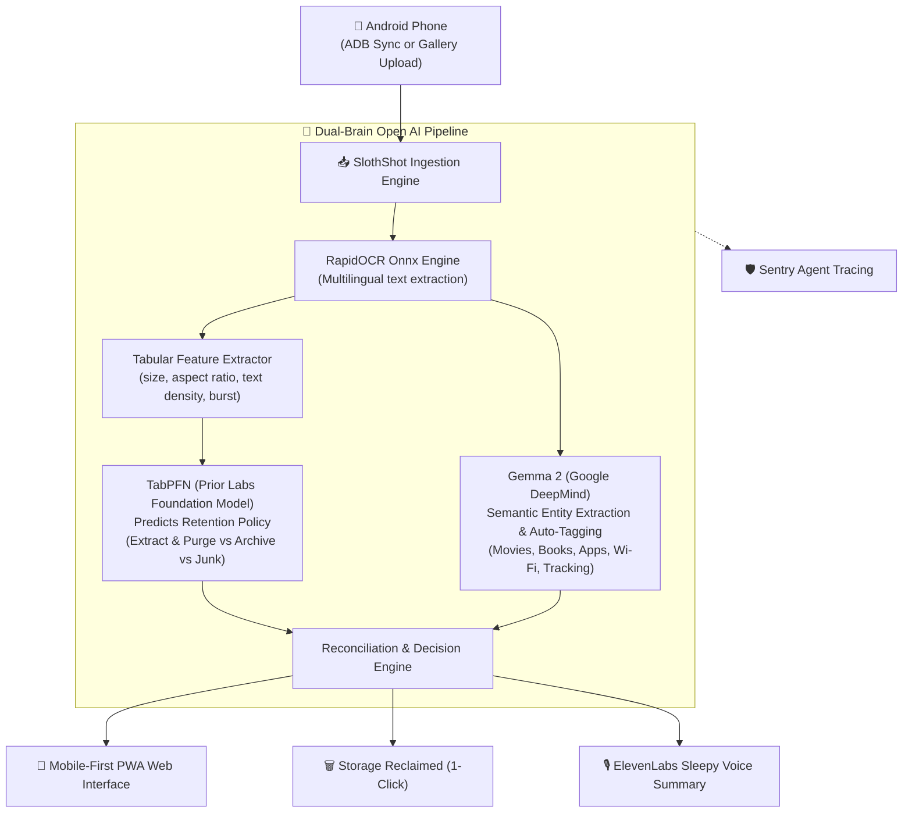

# 🦥 SlothShot

> **The Zero-Effort Android Screenshot Triage & Second Brain Butler**  
> *Powered by Google Gemma 2, Prior Labs TabPFN, Sentry Agent Tracing, ElevenLabs & Render.*

[](https://www.python.org/downloads/)
[](LICENSE)
[](https://dev.to/challenges/hacktoberfest-week3-2026-10-19)

---

## 📖 The Sloth Manifesto: Why SlothShot Exists

On October 20, the world celebrates **International Sloth Day**. Sloths conserve their energy, avoid unnecessary movement, and let the world come to them.

Modern smartphone users are digital hoarders out of sheer laziness:
- You see a Wi-Fi password in a café, but you're too lazy to type it -> **Screenshot**.
- A friend mentions a movie on Netflix, you don't want to switch apps -> **Screenshot**.
- A book recommendation in an article -> **Screenshot**.
- An OTP security code or a food courier delivery map -> **Screenshot**.

Within a year, your Android phone gallery is an unsearchable digital wasteland of **3,000+ files** named `Screenshot_20261025-142211.png` eating up **4 to 8 Gigabytes** of storage. Finding that one receipt or Wi-Fi password takes 20 minutes of endless scrolling.

**SlothShot does the work so you don't have to.**

---

## ⚡ Key Features

- 🧠 **Dual-AI Architecture**:
  - **Prior Labs TabPFN Foundation Model**: Classifies the lifecycle retention policy (`EXTRACT_AND_PURGE`, `ARCHIVE_WITH_TAGS`, `EPHEMERAL_JUNK`) directly from tabular structural features without retraining.
  - **Google DeepMind Gemma 2**: Reads the screenshot context, extracts structured actionable entities, and generates descriptive semantic filenames.
- 🎬 **Actionable Artifacts Extraction**:
  - **Movies & TV Shows**: Extracts title, director, and year with 1-click links to **IMDb** and **Letterboxd**.
  - **Books**: Extracts title and author with 1-click links to **Goodreads** and **Google Books**.
  - **Apps & Repos**: Extracts app names with direct search links to **Google Play Store** and **GitHub**.
  - **Wi-Fi Credentials**: Extracts SSID & Password with a 1-click **Copy Password** button.
  - **Package Tracking**: Extracts carrier & tracking codes with instant package lookup.
  - **Receipts & Invoices**: Extracts merchant, date, and amount for tax/expense filing.
- 🏷️ **Smart Auto-Tagging**: Generates `#movie`, `#book`, `#app`, `#wifi`, `#tracking`, `#receipt`, `#junk` for instant filtering.
- 🗑️ **The Lazy Payoff (1-Click Purge)**: Delete single-use OTPs, battery screenshots, and safe-to-delete media in one tap, saving hundreds of megabytes.
- 📱 **Android ADB Sync**: Connect your phone via USB or Wi-Fi; SlothShot pulls, analyzes, and cleans screenshots automatically.
- 🎙️ **ElevenLabs Audio Briefing**: Generates a sleepy, relaxing voice report from the Sloth butler while you rest.
- 🛡️ **Sentry Agent Tracing**: Full telemetry on OCR latency, TabPFN classification scores, and agent execution spans.

---

## 🏛️ Architecture



---

## 🚀 Quickstart

### 1. Run with Docker (Recommended)

```bash
git clone https://github.com/torrua/slothshot.git
cd slothshot
docker compose up -d
```
Open **http://localhost:8000** in your browser.

### 2. Local Python Installation

```bash
git clone https://github.com/torrua/slothshot.git
cd slothshot
pip install -r requirements.txt
pip install -e .
```

### 3. Generate Sample Screenshots for Demo

```bash
python examples/generate_samples.py data/screenshots
```

### 3. Run CLI Triage

```bash
# Scan local folder
slothshot scan data/screenshots

# Sync directly from connected Android phone
slothshot sync
```

### 4. Launch Mobile Web App

```bash
slothshot serve --port 8000
```
Open **http://localhost:8000** on your browser or smartphone.

---

## 📱 Native Android App (Kotlin & Jetpack Compose)

In addition to the Python backend & Web Dashboard, SlothShot includes an **autonomous native Android app** located in [`android/`](android/):

- 🧠 **3-Tier Intelligent Vision & Russian Cyrillic Pipeline**:
  - **Tier 1 (Cloud Multimodal)**: Direct **Gemini 3.5 Flash-Lite & 3.5 Flash Vision** integration for 100% Cyrillic OCR accuracy, structured entity extraction, 75% lower token consumption, and automatic translation of foreign screenshots into Russian.
  - **Tier 2 (On-Device Local VLM)**: **Alibaba Qwen2.5-VL 3B** offline multimodal vision model (~1.85 GB GGUF). Features a built-in background streaming downloader with notification progress, dynamic resolution ViT, and zero API keys required.
  - **Tier 3 (Lightweight Offline Fallback)**: On-device **Tesseract 5.5 OpenMP** with bundled Russian Cyrillic (`rus.traineddata`) & English models + **Google ML Kit** on-device translation to Russian.
- 🔍 **Interactive Screenshot Viewer & Raw Text Selection**:
  - Click on any thumbnail to open the **Full-Screen Zoomable Viewer** with pinch-to-zoom (1x–5x), pan, and system gallery launch.
  - Raw OCR inspection bottom drawer with native touch text selection and copy handles via Jetpack Compose `SelectionContainer`.
- 🦥 **Background Screenshot Monitor**: A background `ContentObserver` watches `MediaStore.Images.Media.EXTERNAL_CONTENT_URI` in real-time.
- 🔔 **Instant Action Notifications**:
  - `[📋 Copy Code / Password]`: Extracts 2FA/OTP codes and Wi-Fi credentials with 1-tap clipboard copy.
  - `[🗑️ Purge]`: Delete ephemeral screenshots straight from the notification banner.
- 🧹 **1-Click MediaStore Storage Reclaim**: Uses Android 11+ `MediaStore.createDeleteRequest()` to safely trash accumulated temporary screenshots in batch.

### Building the Android APK:
```bash
cd android
./gradlew assembleDebug
```
The installable APK will be at `android/app/build/outputs/apk/debug/app-debug.apk` (or install pre-built `SlothShot-debug.apk`).


---

## 🏆 Hacktoberfest 2026 Partner Tracks

| Category | Partner | How SlothShot Uses It |
| :--- | :--- | :--- |
| **Featured ($200)** | **Gemma** | Multimodal semantic entity extraction, movie/book identification, auto-tagging. |
| **Featured ($200)** | **TabPFN** | Prior Labs tabular foundation model predicting screenshot lifecycle retention from structural features. |
| **Featured ($200)** | **Render** | 1-click cloud deployment via `render.yaml`. |
| **Partner ($100)** | **Sentry** | Distributed Agent Tracing instrumenting OCR, TabPFN, and Gemma execution spans. |
| **Partner ($100)** | **ElevenLabs** | Sleepy voice debriefing from the Sloth butler summarizing reclaimed storage. |

---

## 📄 License

MIT License. Built with ❤️ for lazy humans everywhere.
